# YT Cartell Studio — посібник користувача

Як користуватися студією: де що лежить, п'ять кроків проєкту, режими, інструменти й налаштування.
Як зібрати й запустити програму — у [README](../README.md).

## Де що лежить

| Що | Де |
|---|---|
| Проєкти й усі згенеровані файли | за замовчуванням `Документи\YT Cartell Studio\projects\<id>\` — `project.json`, `images\`, `videos\`, `audio\`, `montage\`, `materials\` (твої фото), `reference\` (розбір прикладу), `export\` (пакети для редакторів), `user\` |
| Замінені версії кадрів, кліпів і голосів | `trash\` усередині проєкту — оплачене не видаляється, поки є проєкт |
| Налаштування й ключі (лише на цьому комп'ютері) | `%AppData%\YT Cartell Studio\config.json` |
| Резервні копії налаштувань (перед імпортом, до 5 останніх) | `%AppData%\YT Cartell Studio\config.json.bak-<дата>`, `profiles.json.bak-<дата>` |
| Профілі | `%AppData%\YT Cartell Studio\profiles.json` |
| Стан ключів озвучки (самих ключів там немає — лише маски) | `%AppData%\YT Cartell Studio\tts-keys.json` |
| Стан Telegram-бота (без токена) | `%AppData%\YT Cartell Studio\telegram-bot.json` |
| Локальне розпізнавання мови (whisper.cpp і модель) | `%AppData%\YT Cartell Studio\whisper\` |
| FFmpeg, який поставила студія | `%LOCALAPPDATA%\YT Cartell Studio\ffmpeg\` (Mac — `~/Library/Application Support/YT Cartell Studio/ffmpeg/`) |
| Журнал — надішли його, якщо щось зламалось | `%AppData%\YT Cartell Studio\studio.log` (перезаписується при кожному запуску) |

Папку з проєктами можна змінити: **Налаштування → Дані → «Змінити…»** (наприклад, на диск із більшим
місцем). Студія почне працювати з новою папкою; наявні проєкти лишаються в старій — їх можна
перенести вручну, скопіювавши папки з `projects\`. Там само — «Відкрити журнал» і «Показати в папці».
Видалення проєкту прибирає всю його папку.

## Як почати

На **Головній** встав історію в картку «Нова історія» (або імпортуй `.txt`, або надиктуй мікрофоном),
за бажанням додай фото героїв («Матеріали: Додати фото героїв»), вибери профіль, мову, тривалість,
звук і що в кадрі — і тисни:

- **«Автопілот»** — студія сама пройде всі кроки; прогрес — у «Черзі», результат — у проєкті;
- **«Покроково»** — відкриється проєкт, і ти проведеш його крок за кроком.

Там само — швидкі дії: «Нова історія» (`Ctrl+N`), «Автопілот», «За прикладом», «Перекласти проєкт»,
«Своя озвучка», «Обкладинка». Меню ⋯ на картці проєкту: відкрити, перекласти, дублювати, показати в
папці, видалити.

## П'ять кроків

Угорі проєкту — назва, прогрес «Крок x/5», профіль і кнопка «Автопілот»; праворуч — картка з
наступним кроком. Поки йде робота, видно прогрес і «Зупинити»: нові задачі не стартують, а вже
запущені кадри, кліпи й голоси доробляться й збережуться. Повторний запуск генерує лише те, чого ще
немає, — готове не перемальовується. Перед тим як переробляти вже готове, студія перепитає.

1. **Сценарій** — три режими: «Ідея» (ШІ сам напише текст озвучки під потрібну тривалість), «Готовий
   сценарій» (озвучимо дослівно, тривалість — за довжиною тексту) і «Своя озвучка» (завантаж запис,
   за бажанням — **«Текст із таймкодами»**, → «Розпізнати мову» або одразу «Створити план»). Картка
   **«Матеріали»** — твої фото героїв, місць, предметів і зразок стилю. Нижче — картки налаштувань:
   тривалість (15 с … 30 хв або своя), формат 16:9 / 9:16, мова фільму, **звук**, **що в кадрі**,
   голос оповідача з прослуховуванням, тон оповіді, стиль кадрів (галерея з пошуком), жанр або ніша,
   камера, темп, модель кадрів (Nano Banana 2 / Pro / 2 Lite), режим відео (звичайний, розкадровка
   3×3, ланцюжок кадрів), «Побажання режисеру» і «Свій стиль». Профіль — «Застосувати профіль» або
   «Зберегти як профіль». → **«Створити план»**. У проєкті «За прикладом» тут же — картка
   **«Розбір прикладу»**.
2. **План** — ШІ пише назву, короткий опис, спільний стиль кадрів, персонажів (зовнішність і свій
   голос для кожного) або об'єкти й мотиви, локації й сцени. Герої й місця з твоїх фото — під твоїми
   іменами. Усе редагується й зберігається само, щойно перестанеш друкувати. У сцені — хто говорить,
   де, хто в кадрі, текст озвучки (або «Репліки в кадрі» для «Голосу у відео»), «Текст у кадрі»,
   промти кадру й руху; «Переписати промти ШІ» з побажанням, вище/нижче, вставити, видалити.
3. **Розкадровка** — спершу обличчя героїв і місця (з твоїх фото — одразу готові), потім перший кадр
   кожної сцени з ними, тож герої однакові в усіх сценах. У режимі 3×3 — аркуш із дев'яти кадрів на
   сцену. Будь-який кадр можна перемалювати, змінити його промт або завантажити свій; клік відкриває
   його на весь екран.
4. **Відео й озвучка** — «Все разом» знімає кліпи й озвучує репліки; можна окремо «Зняти відео» чи
   «Озвучити», а «Перезняти змінені» переробить лише те, що змінилось після зйомки. У кожній сцені —
   програвач, голос і кнопки «Зняти» / «Озвучити». У «Голосі у відео» окремої озвучки немає.
5. **Монтаж** — таймлайн із переглядом: перетягни сцену, щоб змінити порядок, тягни краї кліпу, щоб
   обрізати, вибери перехід після сцени; масштаб — повзунком або Ctrl + коліщатко. Під кліпами —
   **доріжка голосу**: репліку можна посунути й обрізати (див. «Голос на таймлайні»). Далі — «Звук»
   (фонова музика, гучність, приглушення під голосом, звук самих кліпів), переходи, ефекти руху,
   фільтри й субтитри (без, файлом `.srt` або прямо у відео). **«Змонтувати відео»** кредитів не
   витрачає. Готовий `.mp4`: «Відкрити», «Показати в папці», «Зберегти як…», «Субтитри .srt»,
   **«Експортувати в…»** (DaVinci Resolve, Premiere, Final Cut, CapCut…).
   Тут же **обкладинка**: намалюй картинку або візьми кадр сцени чи свою, додай заголовок
   (`*слово*` стане кольоровим), підзаголовок і бейдж, вибери шаблон і шрифт → «Застосувати» —
   готовий JPEG 1280×720 (для 9:16 — 1080×1920), до 2 МБ, як хоче YouTube.

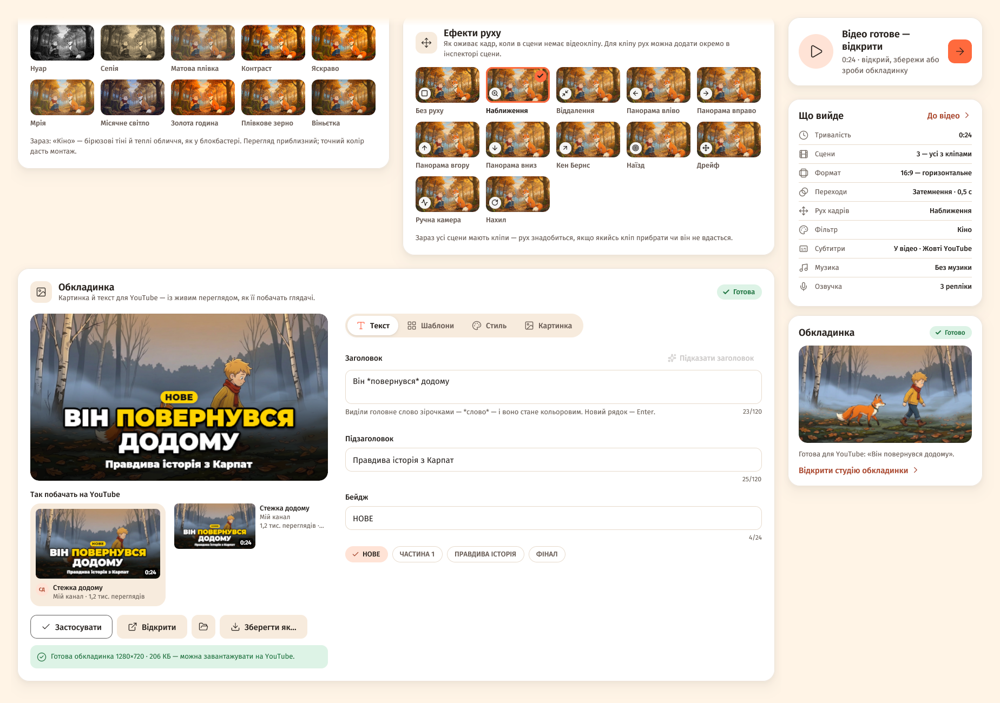

## Режими й інструменти

### Режими «Звук» і «Що в кадрі»

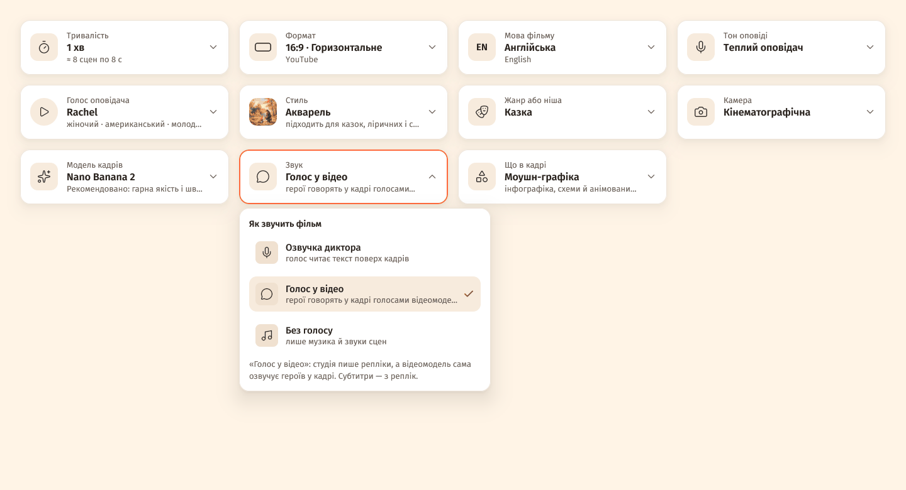

Де: крок **«Сценарій»** → картки **«Звук»** і **«Що в кадрі»**. Ті самі вибори є у вікні «Новий
проєкт», у чипах під історією на Головній, у профілях і в Telegram-боті.

**«Звук» — як звучить фільм:**

- **«Озвучка диктора»** — диктор читає текст поверх кадрів (як було завжди).
- **«Голос у відео»** — герої говорять прямо в кадрі. ШІ пише репліки, а відеомодель сама озвучує
  героїв. Окремого кроку озвучки немає, субтитри — з реплік.
- **«Без голосу»** — лише музика й звуки сцен. Замість тексту озвучки в сцені — «Підпис» (для
  субтитрів).

**Як зробити фільм, де герої говорять:**

1. **Налаштування → Підключення → «Відео»** — модель зі звуком: **Veo 3.1** або **Omni Flash**
   (через G-Labs, Google чи RoyalTechno).
2. Крок «Сценарій» → «Звук» → **«Голос у відео»**. Картка «Голос оповідача» вимкнеться — у героїв
   свої голоси у відео.
3. **«Створити план».** У кожній сцені замість «Текст озвучки» — **«Репліки в кадрі»**: хто говорить
   (герой або «Голос за кадром»), як («пошепки, радісно…», англійською) і що звучить. До 8 реплік на
   сцену («Додати репліку» / «Прибрати репліку»); лічильник «≈ X с із Y с» підкаже, якщо репліка
   довша за кліп.
4. У картці героя — **«Голос у відео (англ.)»**, у картці «Загальне» — **«Голос за кадром (англ.)»**:
   так відеомодель озвучить репліки.
5. Далі як завжди: кадри → «Зняти відео» → монтаж. Звук кліпів грає на повну, музика під ним тихішає.

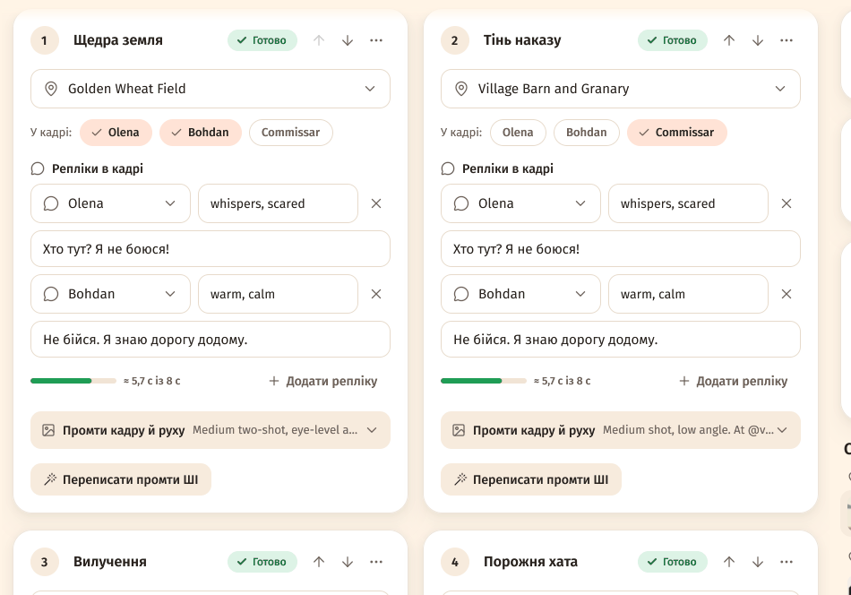

**Які відеомоделі говорять:**

| Відеомодель | «Голос у відео» |
|---|---|
| G-Labs (Veo 3.1, Omni Flash), Google (Gemini Omni Flash, Veo 3.1), RoyalTechno (omni-flash, veo-3.1), Sora 2 | так |
| Seedance 2.0, Grok Imagine, Kling, Wan та інші моделі свого API | залежить від моделі — спробуй одну сцену |
| Runway Gen-4, Luma Ray, MiniMax Hailuo, Seedance 1, Veo 2 | ні — кліпи без звуку |

Якщо модель знімає без звуку, студія попередить: «Відеомодель у Налаштуваннях знімає без звуку —
репліки героїв не прозвучать. Для «Голосу у відео» вибери Veo 3.1 або Omni Flash.»

- З **«Динамічною довжиною сцен»** кліп підганяється під репліки (+1 с), 4–10 с.
- **«Перекласти проєкт»** перекладає й репліки, але кліпи з репліками треба перезняти — вони говорять
  мовою оригіналу (студія про це скаже).

**«Що в кадрі»:**

- **«Персонажі»** — герої, що повторюються в сценах.
- **«Без людей»** — місця, предмети, природа: у плані замість персонажів — «Об'єкти й мотиви», у
  кожному промті — «без людей». Твої фото героїв і предметів стають об'єктами.
- **«Моушн-графіка»** — інфографіка й анімований текст: кадри — дизайнерські композиції з місцем під
  текст («Мотиви графіки», «Фони й локації»).
- **«Змішано»** — герої, b-roll і графіка.

**Анімований текст у кадрі** — перемикач у тій самій картці («Заголовки, числа й підписи студія сама
анімує поверх сцен під час монтажу»). Для моушн-графіки він увімкнений сам, для інших режимів —
вмикаєш ти. У плані в сцені з'являється блок **«Текст у кадрі»**: «Заголовок (до 6 слів)», «Число чи
факт: 73%», «Підпис (необов'язково)» і анімація — «Анімація: авто», «Поява», «Виїзд збоку»,
«Пружний «поп»», «Лічильник числа», «Слово за словом». ШІ ставить текст у сцени з ключовими фактами
(у моушн-графіці — у кожну). Текст стоїть унизу кадру (у моушн-графіці — по центру). Перезнімати
кліп не треба: правки видно після «Змонтувати відео».

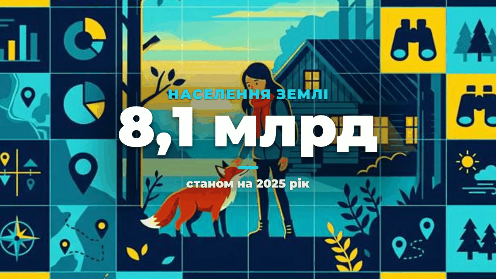

Для цих режимів додано стилі «Моушн-графіка», «Кінетична типографіка», «Документальний b-roll»,
«Предметна зйомка» і жанри «Пояснювальне відео», «Топ-список», «Огляд продукту», «Подорожі й місця».

### Перезняти за прикладом

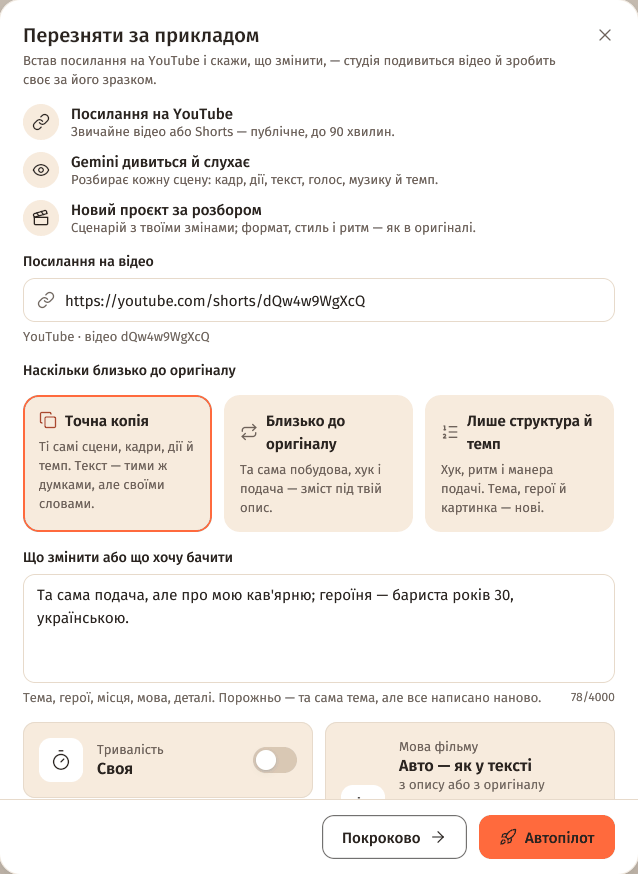

Встав посилання на YouTube — Gemini сам подивиться й послухає відео (на твій комп'ютер нічого не
завантажується), розбере його сцена за сценою: кадр, дії, текст на екрані, голос, музику й темп. За
цим розбором студія пише новий сценарій з твоїми змінами — і далі звичайний проєкт або автопілот.

**Що потрібно:** ключ **Google AI Studio** — Налаштування → Підключення → «Google AI Studio»
(створити: [aistudio.google.com/apikey](https://aistudio.google.com/apikey)). Замість нього може
підійти текстовий сервіс, якщо він уміє дивитися YouTube, — студія перевіряє це сама.

1. **Головна → «Швидкі дії» → «За прикладом»** (або «Новий проєкт» → «Перезняти за прикладом»).
2. **«Посилання на відео»** — `youtube.com/watch?v=…`, `youtu.be/…` або Shorts.
3. **«Наскільки близько до оригіналу»** — «Точна копія», «Близько до оригіналу» (типово) або «Лише
   структура й темп».
4. **«Що змінити або що хочу бачити»** — тема, герої, місця, мова, деталі. Порожньо — та сама тема,
   але все написано наново.
5. **«Тривалість»** — «Як в оригіналі» (студія сама підбере кількість сцен) або «Своя».
6. **«Мова фільму»** (Авто — з опису або з оригіналу) і **«Профіль»**: «Як у прикладі» (формат,
   стиль кадрів, темп, звук і камера — з оригіналу) або твій профіль (стиль кадрів, голос і монтаж —
   з профілю; формат, темп і звук — як в оригіналі).
7. **«Хто дивиться відео»** — «Авто», «Google AI Studio» або «Текстовий сервіс».
8. **«Автопілот»** — до готового відео, або **«Покроково»** — розбір і сценарій, далі ти сам.

**Що далі.** Відкриється проєкт «Перезйомка за прикладом» — на кроці «Сценарій» картка **«Розбір
прикладу»**: «Перевіряю посилання» → «Gemini дивиться й слухає відео» → «Пишу сценарій за розбором».
Проєкт можна закрити — прогрес є в «Черзі». Коли готово: мініатюра, факти (скільки сцен в оригіналі,
склейок за хвилину, формат, звук, хто в кадрі) і текст розбору, який можна правити.
**«Переписати сценарій»** напише сценарій наново з твоїми правками; **«Подивитися ще раз»** —
новий перегляд (правки в розборі зникнуть). Далі — «Створити план», як завжди.

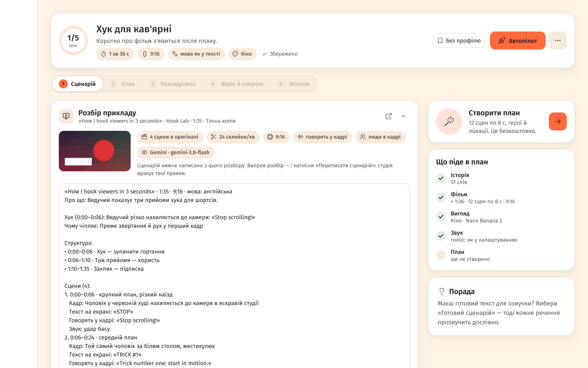

**Як працює точність:**

- **«Точна копія»** — ті самі сцени, порядок, тривалості, плани, рухи камери, дії, текст на екрані
  й темп. Текст — тими самими думками, але своїми словами. План іде за сценарієм кадр у кадр.
- **«Близько до оригіналу»** — та сама побудова, хук, типи кадрів, темп і подача; тема, деталі,
  герої й місця — під твій опис.
- **«Лише структура й темп»** — лише схема хука, ритм склейок і манера подачі; тема, герої й
  картинка — нові.
- Завжди: твоє побажання важливіше за приклад; речення не копіюються (цитата — до 8 слів); без
  реальних впізнаваних людей, логотипів і брендів.
- Сцен = тривалість ÷ довжина кліпу з налаштувань (до 150); кожна сцена перезнімає свою частину
  оригіналу.

**Обмеження:**

- **Лише публічні відео.** Приватні, «доступ за посиланням», з віковим обмеженням, видалені й
  незавершені трансляції не підходять — студія скаже одразу, ще до перегляду.
- **До 90 хвилин.** До 12 хв Gemini дивиться за раз; довші — частинами по 10 хв (після 30 хв — у
  зниженій якості).
- **Безкоштовний ключ Google — до 8 годин YouTube на день.** Вичерпано — студія візьме інший ключ
  (вичерпаний відпочиває добу) або попросить спробувати пізніше.
- Зберігаються лише мініатюра й розбір (`reference\` у папці проєкту).
- У Telegram-боті — «🔁 За прикладом» або `/remake`: посилання → побажання → точність, тривалість,
  профіль, режим (типово — автопілот).

### Мікрофон: диктування на Головній

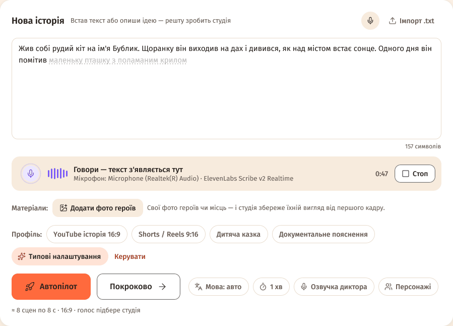

1. **Головна → «Нова історія» → кнопка мікрофона** в шапці картки. Не налаштовано — студія покаже
   «Диктування ще не налаштоване» → «Відкрити налаштування».
2. **Налаштування → Підключення → «Диктування»:** «Сервіс» («Автоматично» — перший готовий),
   «Мова» («Визначати самому» або вибери свою — так точніше), «Мікрофон», «Зупиняти після тиші»
   (типово 8 с; 3 с … 1 хв або «Не зупиняти») → «Перевірити» (нічого не записує).
3. Натисни мікрофон і говори. Під полем — «Говори — текст з'являється тут», рівень звуку й час.
   Текст стає там, де курсор; ще не підтверджені слова — бліді, з пунктиром.
4. **Стоп** — ще раз мікрофон, «Стоп» або Esc. Ще зупиняється після тиші, через 15 хвилин і коли
   перемикаєшся в інше вікно. Сказане вже в полі.

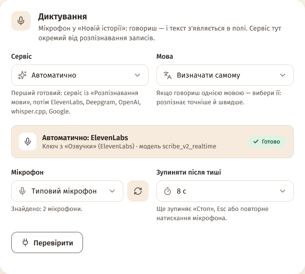

| Сервіс | Як працює | Ключ |
|---|---|---|
| ElevenLabs Scribe v2 Realtime | у реальному часі | ключ озвучки ElevenLabs (або свій) |
| OpenAI Realtime (GPT Live Transcribe) | у реальному часі | свій або з «Розпізнавання мови» / «Текст» / озвучки (ключ api.openai.com) |
| Deepgram Nova-3 | у реальному часі | свій ключ Deepgram; українську вибери в «Мова» (сам визначає лише 10 мов, без української) |
| AssemblyAI Universal-Streaming | у реальному часі | з «Розпізнавання мови» або свій; **української поки немає** |
| OpenAI-сумісний сервіс (фразами) | фразами | адреса й ключ з «Розпізнавання мови» чи «Текст» |
| Google AI Studio (Gemini, фразами) | фразами | ключі Google AI Studio (чергуються) |
| whisper.cpp на цьому комп'ютері | фразами, без інтернету | не потрібен — встанови в «Розпізнавання мови» → «Локально» |

- «Автоматично» бере перший готовий: сервіс із «Розпізнавання мови», потім ElevenLabs, Deepgram,
  OpenAI, whisper.cpp, Google.
- Для української не бери AssemblyAI. Для сервісів на Whisper вибери мову вручну — на коротких
  фразах він інколи плутає українську з російською.
- Мікрофон слухає FFmpeg — він має бути встановлений. Windows: Параметри → Конфіденційність →
  Мікрофон → доступ для класичних програм. macOS: під час першого натискання система спитає дозвіл;
  якщо відмовив — Системні параметри → Конфіденційність і безпека → Мікрофон.

### Telegram-бот: керування з телефона

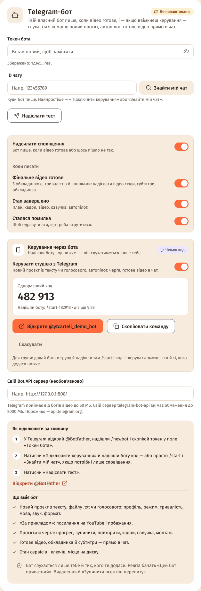

Твій власний бот: новий проєкт текстом, файлом `.txt` чи голосовим, «За прикладом», проєкти, черга,
прогрес наживо й готове відео прямо в чат. Бот працює, **поки студія відкрита на комп'ютері**.

**Підключення:**

1. У Telegram відкрий **@BotFather** → `/newbot` → ім'я й username → скопіюй токен.
2. Студія: **Налаштування → «Сповіщення» → картка «Telegram-бот» → «Токен бота»** → встав → Enter.
3. Блок **«Керування через бота»** → увімкни «Керувати студією з Telegram» (або «Підключити
   керування»). З'явиться **«Одноразовий код»** — 6 цифр, діє 10 хвилин, лише раз (5 помилок — код
   скасовується).
4. **«Відкрити @твій_бот»** → у Telegram «Почати» (код піде сам) — або «Скопіювати команду» і
   надішли боту `/start 482913`.
5. Бот відповість «✅ Керування підключено…», у студії — «Працює» і «Слухається: <ім'я>». ID чату
   підставиться сам.
6. За бажанням: «Надсилати сповіщення» і «Коли писати» («Фінальне відео готове», «Етап завершено»,
   «Сталася помилка»), «Живий прогрес у чаті», «Надіслати тест».

**Меню бота:** «🎬 Новий проєкт», «🔁 За прикладом», «📁 Проєкти», «⏳ Черга», «⚙️ Профілі»,
«📊 Статус»; команди `/menu`, `/new`, `/remake`, `/projects`, `/queue`, `/status`, `/cancel`, `/help`.

- **Новий проєкт:** надішли історію текстом, файлом `.txt` (до 1 МБ) або голосовим (до 20 МБ — бот
  розпізнає його сервісом із «Розпізнавання мови» й покаже текст на підтвердження). Далі одне
  повідомлення з налаштуваннями: «👤 Профіль», «🔀 Режим» (Автопілот / Покроково), тривалість
  (30 с, 1, 3, 5 хв або своя від 10 с до 60 хв), «🌐 Мова», «🎙 Звук», «🎞 Що в кадрі», формат
  16:9 / 9:16 → «▶️ Запустити».
- **Проєкти:** по 6 на сторінці; картка — крок, прогрес, наступна дія, «🚀 Автопілот»,
  «⏹ Зупинити», «🔁 Повторити невдалі», «🖼 Кадри», «🎙 Озвучка», «✂️ Монтаж», «⬇️ Надіслати відео»,
  «📄 .srt», «🖼 Обкладинка», «🗑 Видалити».
- **Черга:** що генерується (з кнопками зупинки), «⏹ Зупинити все», нещодавні помилки з «🔁».
- **Профілі:** профіль за замовчуванням для автопілота й нових проєктів.
- **Статус:** перевірка всіх сервісів, ключі озвучки, вільне місце на диску, версія.

**Живий прогрес:** одне тихе повідомлення на роботу, оновлюється кожні ~3 с (етап, смужка, %, час,
«⏹ Зупинити», «📂 Проєкт»). Запущене з бота — одразу; запущене на комп'ютері — через 20 с, якщо
увімкнено «Живий прогрес у чаті». Наприкінці повідомлення стає результатом із «🔁 Повторити».

**Відео в чат:** під «🎬 Відео готове» — «⬇️ Надіслати відео сюди», «📄 Субтитри .srt», «🖼 Обкладинка
в повній якості». Telegram приймає від ботів файли **до 50 МБ**. Більше — бот запропонує:

- **«🗜 Стиснути до 50 МБ»** — копія, що вміщається (якість трохи нижча; 720p, якщо треба; потрібен
  FFmpeg);
- **«✂️ Надіслати частинами»** — кілька файлів до 49 МБ без перекодування;
- або **свій Bot API сервер** (`telegram-bot-api`): поле «Свій Bot API сервер (необов'язково)», напр.
  `http://127.0.0.1:8081` — тоді до 2000 МБ.

**Група:** додай бота в групу → у студії «Підключити керування» → у групі надішли `/start <код>`
(кнопка «Відкрити» веде лише в особистий чат). Керувати можуть ти й ті, кого додаси в «Хто ще може
керувати в групі» (числовий ID, напр. з @userinfobot) або кнопкою «Дозволити» біля тих, хто писав у
групі без доступу. У групі меню — кнопками під повідомленнями. Якщо бот не бачить звичайних
повідомлень у групі — надсилай їх відповіддю (Reply) на повідомлення бота або вимкни в @BotFather
режим приватності (`/setprivacy` → Disable).

**Безпека:**

- Бот слухається лише тебе й тих, кого ти додав, і лише в підключеному чаті. Решта бачать «Цей бот
  приватний» — без назв проєктів і без підказок.
- «🗑 Видалити» і «⏹ Зупинити все» — лише з другого натискання (протягом 2 хвилин).
- Токен — як пароль: студія показує лише маску й не пише його в журнал. Якщо токен потрапив до
  чужих — у @BotFather `/revoke` і встав новий токен.
- Один бот — одна студія. Друга копія на цьому ж комп'ютері чекає, а інша програма чи комп'ютер із
  тим самим токеном дасть «Не працює» з поясненням і кнопкою «Спробувати знову». Після перенесення
  налаштувань на інший ПК керування там вимкнене, доки не ввімкнеш.
- Надіслане, поки студія закрита, Telegram зберігає до 24 годин — студія виконає це після запуску.
- «Відключити» — бот перестане слухатися команд; сповіщення працюватимуть.

### Експорт у редактори

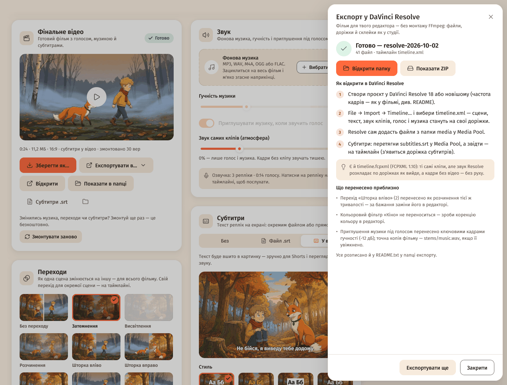

Перенеси фільм у свій редактор: кліпи з обрізкою й переходами, голос, музика, текст у кадрі й
субтитри — кожне на своїй доріжці. Кредитів не витрачає (потрібен FFmpeg); монтувати в студії перед
цим не обов'язково.

1. Крок **«Монтаж»** → картка «Фінальне відео» → **«Експортувати в…»** (або меню ⋯ проєкту →
   «Експортувати в редактор…») → вибери редактор.
2. **«Що включити»:** «Озвучка», «Музика», «Субтитри», «Текст у кадрі», «Обкладинка», «Звук окремими
   доріжками» (голос і музика двома WAV на всю довжину; для CapCut і «Лише файли» — завжди).
3. **«Як зберегти»:** «Папка» або «Папка + ZIP»; «Куди» — типово папка проєкту › `export`.
4. **«Експортувати»** (не все готово — «Експортувати те, що є»: сцена без відео піде кадром із рухом).
5. **«Відкрити папку»** — кроки «Як відкрити в …» є у вікні й у `README.txt`.

**У папці:** `media\` (кліпи `001_scene.mp4`, кадри `001_frame.jpg`, `001_hold.jpg`, голос
`001_voice.*`, текст `001_text.png`, музика), файл таймлайну, `subtitles.srt`, `cover.jpg`,
`edit-list.csv` (монтажний лист), `README.txt`, `stems\voice.wav` і `stems\music.wav`. Кліпи на тому ж
диску — посиланнями, місця не займають. Доріжки: V1 — сцени, V2 — текст у кадрі, A1 — звук кліпів,
A2 — голос, далі — музика з приглушенням під голосом (−12 дБ).

| Редактор | Таймлайн | Як відкрити |
|---|---|---|
| **DaVinci Resolve 18+** | `timeline.xml` (**рекомендовано**, найточніший), `timeline.fcpxml`, `timeline.edl` | File → Import → Timeline… → `timeline.xml`; Resolve сам додасть файли з `media` у Media Pool. Субтитри: `subtitles.srt` у Media Pool → на таймлайн |
| **Premiere Pro** | `timeline.xml` (Final Cut Pro 7 XML) | File → Import… → `timeline.xml`. Субтитри: File → Import… → `subtitles.srt` → на таймлайн (Captions) |
| **Final Cut Pro 10.5+** | `timeline.fcpxmld` (+ `timeline.fcpxml`) | Скопіюй усю папку на Mac → File → Import → XML… → `timeline.fcpxmld`. Не знайшлися файли — File → Relink Files… → `media`. Субтитри: File → Import → Captions… |
| **CapCut** | без таймлайну — **пакет файлів**: сцени, вже нарізані точно під фільм | Новий проєкт → «Імпорт» → усі `*_scene.mp4` з `media` → виділи й перетягни на таймлайн (вони вже по порядку) → `stems\voice.wav` і `stems\music.wav` на аудіодоріжки з 0:00 → Текст → Локальні субтитри → `subtitles.srt` |
| **Kdenlive 25.04+ / Shotcut** | `timeline.otio`, `timeline.mlt` | Kdenlive: File → OpenTimelineIO Import… → `timeline.otio`. Shotcut: File → Open… → `timeline.mlt` |
| **OpenTimelineIO** | `timeline.otio` | Resolve 18.5+ (File → Import → Timeline), Kdenlive 25.04+, Nuke Studio, Hiero, RV або будь-який конвертер OTIO |
| **Лише файли (папка)** | `edit-list.csv` | Пронумеровані файли + монтажний лист: що, звідки (вхід/вихід) і куди ставити |

- **Чому CapCut — пакет файлів, а не чернетка:** CapCut не імпортує монтажні файли (XML, OTIO), а
  його чернетки шифруються або змінюються з кожною версією. Сцени склеєні різко — переходи додай у
  CapCut.
- **Що переноситься приблизно** (список — у вікні після експорту й у `README.txt`): переходи-шторки
  стають розчиненням, «Ручна камера» — нерухомим наближенням, кольорові фільтри не переносяться,
  анімований текст — PNG із плавною появою, голос — з точністю до кадру (точна доріжка —
  `stems\voice.wav`). У `timeline.fcpxml` Resolve розкладає звук як вийде, а кадри без відео — без руху.
- Частота кадрів і розмір — як у кліпів (README підкаже, які вибрати в проєкті редактора).

### Своє API: будь-який сервіс

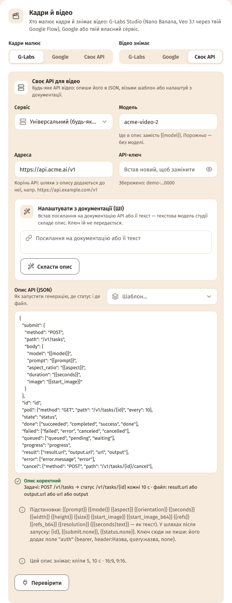

**Налаштування → Підключення → «Кадри» / «Відео»** → «Хто малює кадри» / «Хто знімає відео» →
**«Своє API»** → «Сервіс». Готові пресети: кадри — OpenAI (GPT Image), fal.ai, Replicate, RoyalTechno,
OpenAI-сумісний сервер; відео — fal.ai, Replicate, Runway, Luma (Ray), MiniMax (Hailuo), RoyalTechno.
Для будь-якого іншого сервісу — **«Універсальний (будь-яке API)»**:

1. **«Шаблон…»** — «RoyalTechno (задачі)», «Replicate (predictions)», «fal.ai (черга)», «OpenAI Images
   (синхронно)» (лише кадри), «Простий синхронний: POST → посилання», «Асинхронні задачі (каркас)».
   Заміни шляхи й поля під своє API.
2. Або **«Налаштувати з документації (ШІ)»** — встав посилання на документацію (чи її текст) →
   «Скласти опис». Текстова модель студії прочитає документацію (спершу шукає OpenAPI чи llms.txt) і
   складе опис; ключі їй не передаються. Результат — **«Чернетка від ШІ»** з поясненнями: перевір і
   «Зберегти опис» (або «Відкинути»). До збереження нічого не змінюється.
3. Або встав свій JSON у «Опис API (JSON)».
4. **«Адреса»** (корінь API, напр. `https://api.example.com/v1`), **«API-ключ»**, **«Модель»** (іде в
   `{{model}}`) → **«Перевірити»**.

Студія перевіряє опис наживо: «Опис коректний» + коротко, як він працює, або «Опис має помилки» зі
списком; попередження «Увага: …» (напр., кадр сцени не передається — відео зніметься лише з тексту).

**Основи опису (JSON):**

```json
{
  "submit": {
    "method": "POST",
    "path": "/v1/tasks",
    "body": {
      "model": "{{model}}",
      "prompt": "{{prompt}}",
      "aspect_ratio": "{{aspect}}",
      "duration": "{{seconds}}",
      "image": "{{start_image}}"
    }
  },
  "id": "id",
  "poll": {"method": "GET", "path": "/v1/tasks/{id}", "every": 10},
  "state": "status",
  "done": ["succeeded", "completed", "success", "done"],
  "failed": ["failed", "error", "canceled", "cancelled"],
  "queued": ["queued", "pending", "waiting"],
  "progress": "progress",
  "result": ["result.url", "output.url", "url", "output"],
  "error": ["error.message", "error"],
  "cancel": {"method": "POST", "path": "/v1/tasks/{id}/cancel"},
  "caps": {"lengths": [5, 10], "aspects": ["16:9", "9:16"]}
}
```

- `submit` — запит, що запускає генерацію: `path` додається до «Адреси», `body` — з підстановками.
- `id` + `poll` — де номер задачі й як питати її стан (`{id}`, `every` — секунд). Без них API
  синхронне: файл приходить одразу у відповіді.
- `state` + `done` / `failed` / `queued` — поле стану і його значення; `progress` — відсоток.
- `result` — де шукати файл (посилання, `data:`-URI чи base64; кілька варіантів по черзі); `error` —
  де текст помилки; `cancel` — як скасувати задачу, яку студія перестала чекати.
- `auth` — як передати ключ: `bearer` (типово), `header:Назва`, `header:Назва:Префікс`, `query:назва`,
  `basic`, `none`. Сам ключ в опис не пиши — ключ іде лише на адресу з «Адреси».
- `test` — безкоштовний запит для «Перевірити» (баланс, акаунт, список моделей). Без нього
  «Перевірити» лише перевіряє опис, а ключ і адресу перевірить перша генерація.
- `caps` — що вміє модель: `lengths` (секунди), `maxRefs` (опорні фото), `aspects`, `startFrame`, `size`.
- Підстановки: `{{prompt}}` `{{model}}` `{{aspect}}` `{{orientation}}` `{{seconds}}` `{{width}}`
  `{{height}}` `{{size}}` `{{start_image}}` `{{start_image_b64}}` `{{refs}}` `{{refs_b64}}`
  `{{resolution}}` (`{{seconds|text}}` — як текст); у шляхах після запуску — `{id}`,
  `{{submit.поле}}`, `{{status.поле}}`. Підстановка без значення (напр., немає кадру сцени) прибирає
  своє поле із запиту.

### RoyalTechno

- Пресет **«RoyalTechno»** у «Своєму API» — і для кадрів, і для відео. Ключ `rt_live_…` — у
  Telegram-боті @royaltechno_ai_bot, команда `/api_key`.
- Кадри: `nano-banana-pro` (типово), `nano-banana-2`, `seedream-4.6`, `gpt-image-2`. Відео:
  `omni-flash` (типово), `veo-3.1`, `seedance-2.0`, `seedance-2.0-fast`, `seedance-2.0-mini`,
  `grok-imagine-1.5`, `grok-imagine-1.5-720p`.
- Довжини: Omni Flash — 4/6/8/10 с (до 7 опорних кадрів), Veo 3.1 — 8 с, Seedance — 2–15 с, Grok
  Imagine — 6/10 с. Лише 16:9 і 9:16.
- «Перевірити» нічого не генерує: показує тариф, моделі без ліміту, залишок на сьогодні й баланс.
- «Сцен одночасно» — до 20 (рекомендовано до 10). Розкадровка 3×3 і ланцюжок кадрів працюють через
  пресет RoyalTechno з моделлю `omni-flash` (через «Універсальний» шаблон — ні).

### Google: Gemini Omni Flash

- **Налаштування → Підключення → «Відео» → «Google» → «Модель відео Google»:** «Gemini Omni Flash»
  (типово; кліпи 4/6/8/10 с, до 10 опорних кадрів) або Veo 3.1 / Fast / Lite.
- **Veo 3.1 preview у Gemini API вимикається 22 жовтня 2026.** Студія про це пише біля моделі, а після
  цієї дати сама перемкне на Gemini Omni Flash.
- Розкадровка 3×3 і ланцюжок кадрів тепер працюють і через Google (з Omni Flash).
- 1080p і 4K Omni масштабує з 720p — це довше.
- Картка **«Google AI Studio»**: ключі по одному або «Додати кілька» (ключ `AIza…`, 39 символів);
  кожен ключ одразу перевіряється безкоштовно. Стани: «працює», «відпочиває до …», «помилка»
  (недійсний ключ пропускається годину). Ліміти діють на проєкт Google — бери ключі з різних
  проєктів. «Видалити всі з помилкою», «Прибрати всі».

### Озвучка й ключі

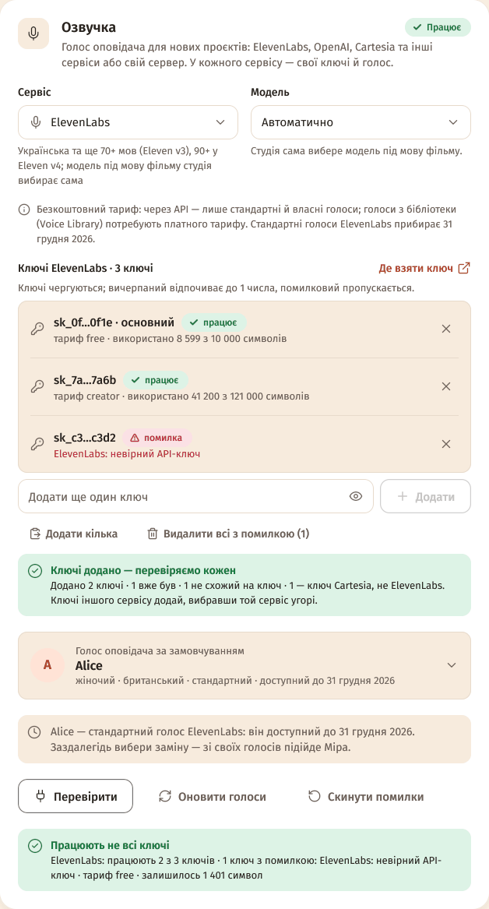

- **Свої ключі в кожного сервісу.** Перемкнув «Сервіс» — ключі, модель і голос попереднього
  збереглися; повернувся — усе на місці.
- **«Додати кілька»** — встав ключі пачкою (з нового рядка, через кому чи пробіл; підписи на кшталт
  `key1:` чи `ELEVENLABS_API_KEY=` студія пропустить) → «Додати й перевірити». Ключ іншого сервісу
  не додасться — студія скаже, чий він («… — ключі ElevenLabs, не Cartesia»).
- **«Видалити всі з помилкою (N)»**, **«Скинути помилки»**, «Перевірити» — усі ключі дешевим запитом,
  без озвучки.
- **Згорнуті списки:** понад 3 ключі — один рядок-підсумок і «Показати всі» → пошук і фільтри
  «Працюють», «Помилка», «Вичерпані».
- **Голос за ID** (Cartesia, ElevenLabs): у виборі голосу → «Вставити ID голосу» → встав ID чи
  посилання → «Знайти голос» → «Використати голос». Голос лишається в «Мої голоси за ID» (до 50 на
  сервіс).
- **ElevenLabs:** стандартні голоси (premade) **доступні до 31 грудня 2026** — студія попередить і
  підкаже заміну зі своїх голосів. Голоси з бібліотеки (Voice Library) через API працюють лише на
  платному тарифі.
- **Розпізнавання мови:** додано **AssemblyAI** — ключ, «Де обробляти» (США / ЄС); українську
  студія розпізнає моделлю Universal-2 сама.

### Перенесення налаштувань на інший комп'ютер

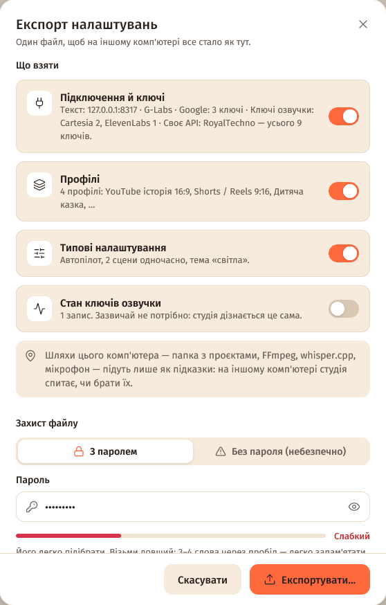

**Експорт:**

1. **Налаштування → «Дані» → «Перенести налаштування на інший комп'ютер» → «Експортувати
   налаштування…».**
2. **«Що взяти»:** «Підключення й ключі», «Профілі», «Типові налаштування» (увімкнено), «Стан ключів
   озвучки» (зазвичай не потрібно).
3. **«Захист файлу»:** «З паролем» (щонайменше 8 символів, двічі) або «Без пароля (небезпечно)» —
   тоді всі ключі у файлі відкритим текстом.
4. **«Експортувати…»** → файл `YT-Cartell-Studio-settings-РРРР-ММ-ДД.ytcs` (типово в «Документах»).

**Імпорт:**

1. На іншому комп'ютері: **Налаштування → «Дані» → «Імпортувати…»** → вибери `.ytcs` → пароль →
   «Відкрити».
2. **«Що імпортувати»** — для кожного розділу **«Замінити»** або **«Об'єднати»**. Об'єднати: твої
   підключення лишаються, ключі з файлу додаються без повторів, ще не налаштовані сервіси беруться з
   файлу; однакові профілі пропускаються, профіль із тією самою назвою додається як «… (імпорт)».
3. **«Шляхи з того комп'ютера»** (папка з проєктами, FFmpeg, whisper.cpp, мікрофон) — беруться,
   лише якщо увімкнеш.
4. **«Імпортувати»** → «Налаштування перенесено». Перед імпортом студія зберігає копію поточних —
   кнопка **«Відновити попередні»** (до 5 останніх копій).

- Шифрування — AES-256-GCM, ключ із пароля (PBKDF2-SHA256, 600 000 ітерацій). Забутий пароль не
  відновити.
- Керування Telegram-ботом на новому комп'ютері вимкнене, доки не ввімкнеш (один бот — один комп'ютер).
- Проєкти не переносяться — скопіюй папку `projects`.
- Той самий файл — **резервна копія**: зроби експорт перед переустановкою Windows.
- Файл від новішої версії студії: відоме перенесеться, решту студія пропустить і попросить оновитися.

### FFmpeg одним кліком

- Немає FFmpeg — на Головній картка «Не знайдено FFmpeg», а в **Налаштування → «FFmpeg — монтаж і
  звук»** — блок «FFmpeg за один натиск» → **«Встановити автоматично»**.
- Студія завантажує офіційну збірку FFmpeg 9.0.2 (Windows — збірка Gyan, ~109 МБ; Mac — Homebrew, а
  без нього — збірки martin-riedl.de), звіряє контрольну суму й ставить у свою папку без прав
  адміністратора. Можна перейти на інші екрани; «Скасувати» — наступного разу завантаження
  продовжиться.
- «Відновити» перевіряє файли копії студії й за потреби завантажує їх знову. «Встановити вручну» —
  кроки й команди (`winget install Gyan.FFmpeg`, `scoop install ffmpeg`, `brew install ffmpeg`).

### Сцен одночасно

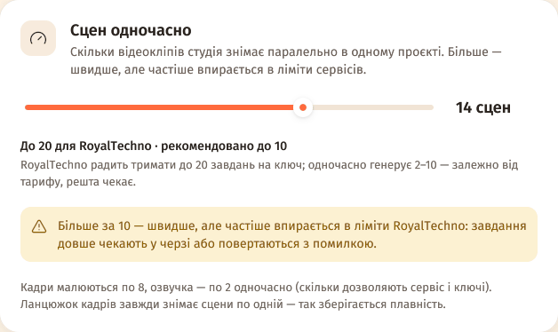

**Налаштування → Підключення → «Сцен одночасно»** — скільки кліпів знімати паралельно. Межа залежить
від сервісу відео; вище рекомендованого студія попередить: «швидше, але частіше впирається в ліміти».

| Сервіс відео | Максимум | Рекомендовано |
|---|---|---|
| G-Labs | 10 | 6 |
| Google | 4 (+2 за кожен додатковий ключ, до 10) | 2 |
| RoyalTechno | 20 | 10 |
| fal.ai | 20 | 4 |
| Replicate | 20 | 6 |
| Runway | 20 | 2 |
| Luma | 10 | 3 |
| MiniMax Hailuo / H3 | 10 / 20 | 4 / 6 |
| Інше своє API | 20 | 4 |

Кадри малюються щонайменше по 4 одночасно (до межі сервісу кадрів), озвучка — за кількістю ключів
(до 8). Ланцюжок кадрів завжди знімає сцени по одній.

### Гучність −14 LUFS і одна копія студії

- **Гучність:** YouTube, TikTok, Instagram і більшість програвачів вирівнюють звук приблизно до
  −14 LUFS, тож тихий фільм звучав би тихіше за сусідні відео. Тепер готовий фільм сам вирівнюється
  до −14 LUFS із запасом піків −1,5 дБ — без компресії, тож мікс із різкими піками може лишитися
  трохи тихішим. Нічого вмикати не треба.
- **Одна копія:** якщо студія вже відкрита, друга не запуститься — Windows покаже «YT Cartell Studio
  уже відкрита — переключись на її вікно». Так дві копії не перезаписують налаштування одна одної.
- **G-Labs:** запит, який G-Labs відхилив через зміст (фільтр безпеки, недопустимі референси),
  більше не повторюється без змін — зміни промт чи референси; покинуті задачі студія зупиняє в
  G-Labs. Omni Flash знімає кліпи на 4 і 6 с і без Google AI Ultra.

## Ще інструменти

### Свої фото героїв і місць («Матеріали»)

- **Де додати:** на Головній під історією — «Додати фото героїв» (до 12 фото); у вікнах «Новий
  проєкт» і «Своя озвучка» — «Додати фото» (до 16); у проєкті на кроці «Сценарій» — картка
  «Матеріали» (до 24 на проєкт).
- Для кожного фото вибери, що це: **Персонаж**, **Локація**, **Предмет** чи **Стиль**, — дай ім'я
  (напр. «Тарас») і, за бажанням, короткий опис.
- Студія сама роздивиться фото («Описуємо фото…»). План візьме героїв і місця під твоїми іменами, а
  фото стане їхнім референсом — без генерації й без витрат. Предмети з'являтимуться в кадрах, зразок
  стилю додасться до стилю фільму.
- Не вийшло роздивитися («Фото не вдалося роздивитися…») — значить, текстова модель не бачить
  картинок: опиши в нотатці, що на фото, і студія візьме твій опис.
- Підходять PNG, JPG і WEBP до 40 МБ. Прибраний матеріал не змінює вже створений план.
- Найкраще працює з автопілотом: герої однакові від першого до останнього кадру.

### Своя озвучка з готовим текстом (таймкоди)

- **«Своя озвучка»** на Головній: вибери запис → у блоці «Текст із таймкодами» натисни «Додати». У
  проєкті — крок «Сценарій», картка «Текст із таймкодами»: «Додати файл», «Замінити» або ✕.
- **Що підходить:** субтитри **SRT** і **VTT** (зокрема з YouTube), **JSON** від ElevenLabs,
  OpenAI/Whisper, Deepgram, AssemblyAI, whisper.cpp та інших сервісів, **TXT** з мітками часу на
  кшталт `[00:12]` (наприклад, розшифровка, скопійована з YouTube). Word чи PDF не підходять —
  збережи текст як TXT або SRT.
- Файл має пасувати до запису: фрази не можуть закінчуватися пізніше ніж за 2 с після кінця запису.
- Тоді студія не розпізнає мову — це швидше й безкоштовно: сцени ріжуться за твоїми таймкодами.
  Помилки в тексті можна виправити в «Плані» — голос усе одно звучить твій.
- Прибереш файл — наступний план знову розпізнає мову сам.

### Розпізнавання мови на своєму комп'ютері

Без ключа й без інтернету: запис нікуди не завантажується. Працює whisper.cpp — один раз
завантажуєш програму й модель, далі все локально. Та сама модель працює й для мікрофона
(«Диктування» → «whisper.cpp на цьому комп'ютері»).

**Windows**

1. **Налаштування → Підключення → «Розпізнавання мови» → «Локально».**
2. Вибери модель: **Small — рекомендована** (≈ 465 МБ) пристойно розпізнає українську й працює
   швидше за запис на будь-якому комп'ютері; **Large v3 Turbo** (≈ 1,5 ГБ) — найточніша, але на
   слабкому комп'ютері повільна; Tiny і Base швидкі, проте в українській помиляються.
3. **«Встановити»** — студія завантажить програму з офіційної сторінки whisper.cpp на GitHub і
   модель із Hugging Face у `%AppData%\YT Cartell Studio\whisper\`. Можна «Скасувати» — наступного
   разу завантаження продовжиться з того ж місця.
4. **«Перевірити»** — і готово.

**macOS**

1. Встанови [Homebrew](https://brew.sh), потім у Терміналі: `brew install whisper-cpp`.
2. У студії: «Розпізнавання мови» → «Локально» → вибери модель → «Встановити» (завантажиться лише
   модель). На Mac розпізнавання прискорюється відеоядром, тож Large v3 Turbo — добрий вибір.

Своя програма чи модель — «Додатково: шляхи до програми й моделі».

### Своє API для кадрів і відео (готові сервіси)

1. **Налаштування → Підключення → «Кадри» / «Відео».**
2. «Хто малює кадри» і/або «Хто знімає відео» → **«Своє API»**.
3. **Сервіс:** для кадрів — OpenAI (GPT Image), fal.ai, Replicate, RoyalTechno або OpenAI-сумісний
   сервер; для відео — fal.ai, Replicate, Runway, Luma (Ray), MiniMax (Hailuo) чи RoyalTechno.
   Будь-який інший — «Універсальний (будь-яке API)» (див. «Своє API: будь-який сервіс»).
4. **API-ключ** і **модель** зі списку (або «Інша модель…» — будь-яка модель сервісу). Адресу лиши
   порожньою — візьметься стандартна; для OpenAI-сумісного сервера впиши його адресу з `/v1` у кінці.
5. **«Перевірити»** — безкоштовно: нічого не генерується й не списується.

Під полями видно, що вміє модель: які довжини кліпів знімає й скільки опорних фото бере. Модель без
опорних фото може міняти вигляд героїв між кадрами — для кадрів краще моделі «…/edit». Розкадровка
3×3 і ланцюжок кадрів працюють лише з Omni Flash (G-Labs, Google, пресет RoyalTechno).

### Довжина сцен: динамічна й Google AI Ultra

У **Налаштування → Підключення → «Відео»**:

- **«Динамічна довжина сцен»** — кожен кліп рівно під свою репліку: 5,7 с мови → 6 с відео, а не 10.
  Фільм щільніший, без зайвих секунд після репліки. Голос сцени озвучується першим, і кліп знімається
  вже під його точну довжину. «Довжина однієї сцени» тоді діє лише для сцен без озвучки.
- **«Google AI Ultra»** (для G-Labs) — увімкни, якщо твій акаунт Google має підписку Ultra: тоді
  G-Labs знімає Veo 3.1 і на 4 та 6 с. Без неї Veo 3.1 знімає по 8 с; Omni Flash знімає 4–10 с і без
  Ultra.
- Динамічна довжина має сенс, коли модель уміє кілька довжин (Omni Flash, G-Labs з Ultra, Google,
  багато моделей свого API). У «Своїй озвучці» кліп і так підганяється під шматок запису.
- На Головній оцінка покаже діапазон, напр. «≈ 12 сцен по 4–8 с».

### Кілька ключів озвучки

- **Налаштування → Підключення → «Озвучка»:** сервіс (ElevenLabs, Cartesia, OpenAI, Google Cloud
  (Chirp 3 HD), Azure AI Speech, MiniMax Speech, Fish Audio, свій сервер), модель («Автоматично» —
  студія вибере під мову фільму) і голос.
- **«Ключі API»:** встав один чи кілька ключів одного сервісу → «Додати» (або «Додати кілька»). Ключі
  чергуються — кожен запит бере наступний.
- Біля кожного ключа — стан: «працює»; «вичерпано до 1 …» — місячний ліміт скінчився, ключ
  відпочиває до 1 числа наступного місяця; «помилка» — сервіс не приймає ключ, він пропускається
  годину; «відпочиває до …» — коротка пауза після ліміту запитів.
- **«Перевірити»** перевіряє всі ключі дешевим запитом — без озвучки й без витрат. **«Скинути
  помилки»** — спробувати помилкові ключі знову.
- Самі ключі лежать лише в `config.json`; у `tts-keys.json` — тільки стан і маска (`sk_ab…12cd`).
- Google Cloud без власного ключа візьме ключі з картки «Google AI Studio» (потрібен увімкнений
  Cloud Text-to-Speech API). Azure: у полі адреси — регіон, напр. `westeurope`.

### Профіль за описом

1. **Налаштування → Профілі → «Новий профіль»** (або «Керувати» біля профілів на Головній).
2. Угорі редактора — **«Налаштувати з опису»**: опиши канал своїми словами, напр. «Казки на ніч для
   малечі 4–7 років, 3 хвилини, м'яка акварель, українською».
3. **«Підібрати налаштування»** — ШІ заповнить тривалість, формат, мову, стиль, жанр, тон, темп,
   голос, монтаж… Підібрані поля підсвічуються, а в «Чому так» — пояснення.
4. Перевір і натисни **«Зберегти профіль»** — до цього нічого не зберігається.

### Голос на таймлайні

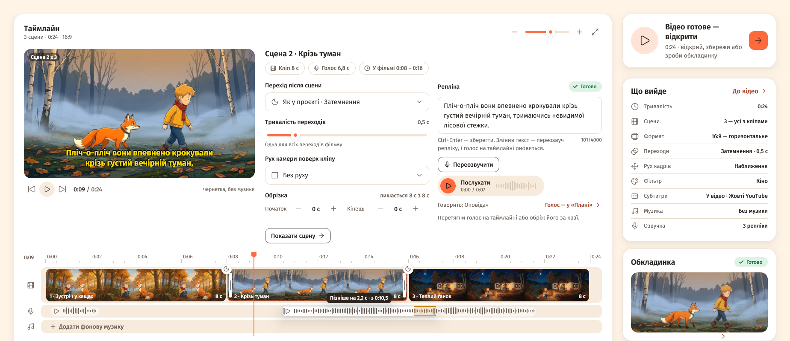

- Під кліпами — доріжка голосу. **Перетягни репліку**, щоб вона звучала раніше чи пізніше:
  картинка не зсувається, а репліка може заходити на сусідню сцену. **Тягни її краї**, щоб обрізати
  зайве на початку чи в кінці.
- Кнопка ▷ на самій репліці програє рівно ту частину, що лишилася після обрізки.
- Клік по сцені → праворуч «Репліка»: виправ текст (Ctrl+Enter — зберегти) і натисни
  **«Переозвучити»** (витрачає кредити). У «Своїй озвучці» замість цього — «Нарізати знову»: шматок
  заново виріжеться із запису.
- Там само видно, наскільки голос зсунуто й обрізано; «Скинути» повертає як було.
- Субтитри йдуть за голосом. Якщо репліки накладаються, студія стежить, щоб звук не «хрипів».

### Нова «Черга»

- Кожна робота — картка з мініатюрами сцен: що готово, що генерується, що чекає (клік відкриває
  сцену в проєкті).
- Коли нічого не генерується — «Що можна запустити»: проєкти, що чекають наступного кроку, з
  кнопкою «Продовжити».
- «Нещодавно» — результати за тиждень, по днях. Етап, де частина сцен не вдалася, теж має
  «Повторити» — переробиться лише те, що не вийшло.

## Налаштування

- **Підключення** — текст; «Кадри» і «Відео» (G-Labs, Google або «Своє API» — у кожної картки свій
  вибір; «Динамічна довжина сцен», «Google AI Ultra»); «G-Labs Studio»; «Google AI Studio» (ключі,
  перевірка кожного); озвучка (сервіс, модель, голос, свої ключі в кожного сервісу); FFmpeg
  («Встановити автоматично»); розпізнавання мови (ElevenLabs, Whisper, AssemblyAI або «Локально»);
  «Диктування»; «Сцен одночасно».
- **Профілі** — картка на кожен профіль: редагувати, дублювати, видалити, «Зробити профілем
  автопілота»; «Новий профіль» відкриває редактор з усіма полями сценарію (зокрема звук і що в кадрі)
  й монтажу та «Налаштувати з опису».
- **Автопілот** — профіль за замовчуванням, обкладинка для YouTube, повторні спроби (0–3) і
  «Монтувати, навіть якщо частина сцен не вдалася» (замість кліпу, що не вийшов, буде його кадр).
- **Сповіщення** — картка «Telegram-бот»: токен, чат, «Надіслати тест», «Коли писати», «Керування
  через бота» (див. «Telegram-бот»).
- **Вигляд** — тема (Світла / Темна / Як у системі), «Менше анімацій», «Показувати поради»,
  «Показати підказки знову».
- **Дані** — папка з проєктами, «Перенести налаштування на інший комп'ютер» (експорт / імпорт
  `.ytcs`), імпорт із веб-версії, журнал роботи; нижче — версія збірки, «Перевіряти автоматично»
  (оновлення) і посилання на спільноту YT CARTELL.

## Відомі обмеження

- **Найбільше перевірено на Windows.** Mac-збірки (macOS 13+) викладаються в той самий реліз, інколи
  трохи пізніше; тема «Як у системі» стежить лише за темою Windows. Локальне розпізнавання на macOS —
  через Homebrew; на Linux встанови whisper.cpp сам і вкажи шлях у «Додатково».
- **Закриття програми зупиняє роботу.** Якщо щось генерується, студія спершу перепитає; зупинені
  етапи продовжиш кнопкою «Повторити» — доробиться лише незроблене. Кліп, який сервіс уже почав
  знімати в момент закриття, не завантажиться, хоча кредити за нього можуть списатися.
  **Telegram-бот і сповіщення працюють, лише поки програма відкрита.**
- **Одна копія студії на комп'ютері.** Друга не запуститься (і не перехопить Telegram-бота).
- **Окрему перегенерацію не зупинити.** Один кадр, кліп чи голос, запущений окремо, доробиться сам;
  «Зупинити» й «Скасувати все» зупиняють етапи.
- На один проєкт — одна робота одночасно (різні проєкти можуть працювати паралельно).
- **До 150 сцен на фільм:** із кліпами по 8 с це близько 20 хвилин (з Omni Flash по 10 с — до 25).
  Довший готовий сценарій обріжеться, а довший запис для «Своєї озвучки» студія не прийме.
- **Розкадровка 3×3 і ланцюжок кадрів — лише з Omni Flash** (G-Labs, Google або пресет RoyalTechno;
  не з іншими моделями й не з «Універсальним» API). З ланцюжком кліпи знімаються по черзі, тож це довше.
- **«Голос у відео» — лише з відеомоделлю, що вміє звук** (Veo 3.1, Omni Flash, Sora 2; інші — може
  бути тиша). Голос героя описується словами («Голос у відео (англ.)») — озвучує його сама
  відеомодель. Позицію тексту в кадрі змінити не можна (внизу, у моушн-графіці — по центру).
- **«Перезняти за прикладом»:** лише публічні відео YouTube до 90 хвилин; безкоштовний ключ Google —
  до 8 годин YouTube на день; потрібен ключ Google AI Studio (або текстовий сервіс, що вміє дивитися
  YouTube).
- **Мікрофон:** потрібен FFmpeg; AssemblyAI у реальному часі української поки не розпізнає; Deepgram
  сам українську не визначає — вибери мову.
- **Telegram:** бот надсилає відео до 50 МБ (більше — стиснути чи частинами, або свій Bot API сервер
  до 2000 МБ); бот приймає файли до 20 МБ; один бот — одна студія.
- **Експорт у редактори:** CapCut — пакет файлів без переходів (не чернетка); шторки стають
  розчиненням, кольорові фільтри не переносяться, анімований текст — PNG із плавною появою.
- **Google Veo 3.1 preview у Gemini API вимикається 22 жовтня 2026** — далі студія знімає через Gemini
  Omni Flash.
- **Фото-матеріали «роздивляється» текстова модель.** Якщо вона не вміє працювати з картинками,
  студія візьме твій опис — тоді пиши його докладніше.
- **Локальне розпізнавання на Windows працює на процесорі.** Small — швидше за запис; Medium і
  Large v3 Turbo на слабкому комп'ютері повільні й потребують близько 2 ГБ пам'яті. Одночасно
  розпізнається один запис.
- **Текст на обкладинці — латиниця й кирилиця.** Емодзі й інші письмена (китайське, арабське…) на
  обкладинці не малюються.
- **Вбудований програвач — для перегляду.** Відео відтворюється через FFmpeg у зменшеному розмірі;
  перемотування перезапускає звук і картинку з нової позиції. Остаточно перевіряй результат
  кнопкою «Відкрити» у звичайному програвачі.
- **Веб- і десктопна версії не синхронізуються:** імпорт — разова копія. Зміна папки з проєктами
  теж не переносить їх — див. «Де що лежить». Перенесення налаштувань не переносить проєкти.
- Обмеження сервісів: на безкоштовному ElevenLabs через API працюють лише стандартні й власні
  голоси, а стандартні ElevenLabs прибирає 31 грудня 2026; Veo 3.1 по 4 і 6 с у G-Labs — лише з
  підпискою Google AI Ultra (перемикач «Google AI Ultra»).
